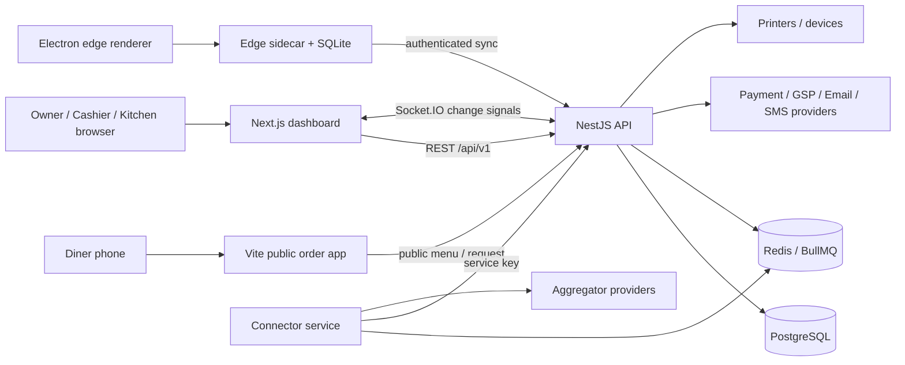
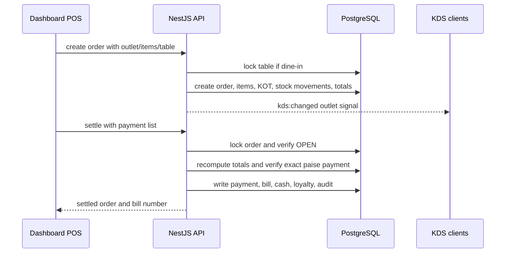

# Stello Kitchens — project handoff and commercial launch dossier

**Purpose:** This is the single restart point for the Stello Kitchens project. It explains what the system is, how its parts connect, what has been implemented, what has been tested, what remains risky, and the order in which work should continue.

**Current decision:** The product is a strong working foundation and can move to a controlled staging/pilot phase. It is not yet ready for an unrestricted commercial launch involving real customer payments. The reasons are mainly real-provider certification, physical hardware, production operations and remaining accounting/reconciliation work rather than missing screens.

**Repository:** `C:\Projects\Pet Pooja Clone`  
**Package manager:** pnpm 10.33.2  
**Baseline audited:** commit `141e65867e932e1da83ec50d20314fc0e171c580` plus pre-existing working-tree changes  
**Last audit/implementation date:** 25 September 2026  
**Market assumption:** India, independent restaurants and small chains

## How to resume

Start with these files in this order:

1. This document.
2. [Implementation plan](IMPLEMENTATION-PLAN.md).
3. [Implementation results](implementation-2026-09-21/RESULTS.md).
4. [Commercial readiness audit](audit-2026-09-21/COMMERCIAL-READINESS-AUDIT.md).
5. [Market and roadmap research](audit-2026-09-21/MARKET-AND-ROADMAP.md).
6. [Evidence and reproduction index](audit-2026-09-21/EVIDENCE-AND-REPRODUCTION.md).
7. Existing product specification: [SPEC.md](SPEC.md).

The audit and implementation folders contain saved JSON results, logs, smoke scripts, migration evidence and local reproduction programs. They are engineering evidence, not production data and not a substitute for a staging or provider certification run.

## Executive status

### Completed and verified

- Staff dashboard, POS, KDS, diner ordering, offline edge POS, inventory, CRM/loyalty, reports, invoices, connector service and deployment stack exist in the repository.
- Settlement concurrency is protected by database row locking and transactional state transitions.
- Refunds reserve cumulative refundable balance, support idempotent request keys and preserve uncertain provider outcomes.
- Table occupancy, table ownership, item/combo ownership, stock receiving and stock wastage are protected against the reproduced races.
- Modifier group minimum/maximum and duplicate-selection validation is enforced at the order boundary.
- Offline sync checks that the pushing terminal is active and belongs to the outlet.
- Offline settled orders must contain payments matching the server total; offline line price and tax snapshots are preserved during server sync.
- Sync pull uses a stable `(updatedAt, id)` cursor.
- QR requests are claimed atomically and returned to `PENDING` when processing fails.
- Suspended and expired tenants cannot authenticate.
- Password reset increments a user token version, revoking old HTTP and socket sessions.
- Socket joins require an active user assigned to the requested outlet.
- Connector push routes require `x-connector-key`.
- Invoice tax splitting allocates the rounding remainder so components add to the exact total tax.
- Dashboard security headers include CSP, frame, referrer, content-type and permissions policy headers.
- Deployment script generates required aggregator webhook secrets and compose supports a versioned server image tag.
- All six workspaces passed type checking and production builds.
- The final fresh-database suite passed **76 tests**; the added transaction-integrity file contains 18 regression tests.
- Fresh PostgreSQL migrations, including refund reservations and session revocation, applied successfully.

### Still open before general availability

- Razorpay/UPI/card capture and refund workflows are not certified; the current payment provider remains a mock seam.
- GSP/e-invoice/e-way-bill responses remain mocked and need a real provider, applicability review and signed acknowledgement handling.
- Email/SMS/OTP providers currently have logging implementations in development paths.
- Receipt printing and hardware recovery need real printers, drivers and power/network-failure tests.
- Aggregator adapters and partner certification remain incomplete; connector authentication is fixed but provider delivery is still simulated.
- The offline edge still has deliberate availability tradeoffs: local open/unsynced sales can be lost if a terminal is destroyed, offline stock can temporarily oversell, and open orders are not shared between terminals. These need product policy, recovery/backup and pilot validation.
- Production-like load, soak, failover, off-site backup restore, rollback and incident drills are not complete.
- Dependency advisories need remediation and a release SBOM/license review.
- Tax place-of-supply/accounting semantics, business-day reporting, refund/void reports and immutable invoice snapshots need qualified review.
- Historical data needs reconciliation after the previously reproduced duplicate/refund/stock defects. Code fixes do not repair old records.
- Subscription billing, entitlements, cancellation, customer export, privacy/retention and support operations need completion.

## Product scope

Stello is an all-in-one restaurant operations platform with these user surfaces:

| Surface | Users | Purpose | Main implementation |
|---|---|---|---|
| Staff console | Owners, managers, cashiers, kitchen staff | Login, onboarding, outlets, menu, POS, KDS, inventory, CRM, reports, invoices, devices, settings | `apps/dashboard` |
| POS billing | Cashiers and owners | Create orders, dine-in/takeaway/delivery, KOT, discounts, loyalty, payment and bill settlement | Dashboard routes/components plus API orders/payments |
| KDS | Kitchen staff | Receive KOTs and advance preparation state through stations | Dashboard KDS and API KDS module |
| Diner order | Restaurant customers | Public table QR and kiosk menu/order request | `apps/order` and API `scan-order` |
| Offline edge POS | Counter terminals | Continue billing during WAN loss using local SQLite, then synchronize | `apps/edge` |
| Connector | Integration workers/operators | Receive aggregator webhooks and push menu/stock/status data | `apps/connector` |
| Cloud API | All authenticated surfaces | Identity, tenancy, order lifecycle, accounting-like records, sync and realtime | `apps/api` |
| PostgreSQL | Application persistence | Tenant, menu, order, payment, inventory, CRM, invoice and audit records | Prisma schema/migrations |
| Redis/BullMQ | Connector background work | Queue and process integration jobs | Compose Redis + connector |

## Software structure

```text
stello-kitchens/
├── apps/
│   ├── api/                 NestJS API, Prisma schema, migrations, seed, tests
│   ├── connector/           NestJS aggregator gateway and BullMQ workers
│   ├── dashboard/           Next.js staff console, POS and KDS
│   ├── edge/                Electron/React offline terminal + Node sidecar
│   └── order/               Vite public diner ordering application
├── packages/
│   └── shared/              Zod schemas, DTOs, types and shared money formulas
├── deploy/                  Dockerfiles, compose, nginx examples, backup/deploy scripts
├── docs/                    Product specification, audit evidence and this handoff
└── package.json             Workspace commands and pnpm configuration
```

### API module map

`apps/api/src` is organized by domain:

| Module | Responsibility |
|---|---|
| `auth`, `account` | Login, JWT, password reset, account lifecycle and token revocation |
| `common` | Decorators, validation pipes, token hashing and tenant context |
| `prisma` | Prisma client and tenant-scoping extension |
| `tenant`, `provisioning`, `onboarding`, `brands`, `outlets` | Tenant graph and restaurant setup |
| `menu`, `combos` | Categories, items, variations, addons, channel menus and combo pricing |
| `orders` | Create/add/cancel/settle, KOT generation, prices, taxes, loyalty and synced orders |
| `payments` | Cash drawer, UPI QR seam, refunds and cash movements |
| `inventory` | Materials, receiving, wastage, recipes, prep batches, stock movements and costing |
| `kds` | Tickets, stations and preparation status |
| `scan-order` | Public QR/kiosk requests, staff acceptance and token board |
| `sync` | Edge snapshot, push and pull synchronization |
| `realtime` | Socket.IO authentication, outlet rooms and lightweight change notifications |
| `crm`, `loyalty` | Customers, points, OTP redemption and campaigns |
| `invoices`, `reports` | Invoices, HSN/GST summaries, exports and operational reports |
| `devices`, `hardware` | Terminal fleet and mock scale/caller-ID bridges |
| `central-kitchen` | Indents and inter-outlet preparation flows |
| `email`, `health` | Notification seam and liveness/readiness probes |

## Runtime architecture



The dashboard and public order applications do not own business rules. They submit validated requests to the API. The API performs authorization, tenant/outlet ownership checks, pricing, tax calculation, stock movement, KOT creation and audit logging. The edge sidecar is intentionally different: it owns a local SQLite copy while disconnected and later submits a server-validated snapshot.

## Core request flows

### Online order and settlement



The settlement lock prevents concurrent clicks or terminals from producing multiple financial effects. A retry after a successful settlement currently receives an “order is not open” response; the effect is safe, but a polished operation-key retry response remains a future improvement.

### Offline edge sale

```mermaid
sequenceDiagram
  participant POS as Edge renderer
  participant SQLite as Edge SQLite
  participant API as Cloud API
  participant PG as PostgreSQL
  POS->>SQLite: create and settle locally
  SQLite-->>POS: provisional offlineRef receipt
  Note over POS,SQLite: WAN unavailable; terminal uses last snapshot
  POS->>API: push active deviceId + immutable line snapshots
  API->>PG: verify device/outlet and payment total
  API->>PG: create authoritative order/KOT/stock/bill
  API-->>POS: server bill number / duplicate / error
```

The authoritative tax bill number is assigned at sync. The edge README documents the remaining availability tradeoffs: device loss can lose unsynced sales, offline terminals can temporarily oversell scarce stock, and open orders are not shared between terminals. These are product policies that must be explicit to customers.

### Public QR order

1. Diner scans an opaque table or kiosk token.
2. API returns public menu data.
3. Diner submits an `OrderRequest`.
4. Staff accepts or rejects it.
5. Acceptance claims the request atomically, creates/updates the open table order and creates a KOT.
6. A failure releases the request to `PENDING`; a successful request becomes `ACCEPTED` with token number.
7. KDS receives the outlet change signal.

### Aggregator order

1. Provider webhook reaches the connector.
2. Connector verifies provider signature and normalizes the payload.
3. Connector reserves/uses an idempotency key.
4. Main API creates the delivery order, KOT and stock movement.
5. Connector reports status back to the provider.

The internal connector push routes now require `x-connector-key`. Provider mapping, credentials, certification and actual outbound delivery remain open.

## Data and tenancy model

Every restaurant belongs to a `Tenant`. A tenant has brands, users, roles and outlets. Users are assigned to outlets through `UserOutlet`; all operational records carry tenant and usually outlet ownership.

Important entities include:

```text
Tenant
 ├── Brand ── Outlet
 │            ├── MenuCategory ── Item ── Variation / AddonGroup / Recipe
 │            ├── Area ── DiningTable ── Order ── OrderItem / KOT / Payment
 │            ├── RawMaterial ── StockMovement / Vendor / PrepRecipe
 │            ├── Customer ── LoyaltyTransaction / Feedback
 │            ├── Terminal
 │            └── Invoice / CashSession / OrderRequest
 └── User ── Role + UserOutlet
```

The API uses request tenant context plus service-level ownership predicates. The important release rule is that both the service and database transaction must validate referenced tenant/outlet IDs; a top-level read filter alone is insufficient.

## What was fixed and how it was verified

The first implementation batch added 18 regression tests in `apps/api/test/transaction-integrity.test.ts`:

- 20 competing settlements produce one payment, bill and loyalty effect.
- Underpayment rolls back cleanly.
- Settlement versus cancellation/item-add races are serialized.
- Foreign tenant/outlet tables are rejected.
- Staff and QR table occupancy creates one open order.
- Offline dine-in retries deduplicate.
- Partial and concurrent refunds cannot exceed captured value.
- Refund request keys deduplicate and reject changed details.
- Unknown provider outcome reserves balance and is not resent blindly.
- Cash movement failures roll back refund records.
- Concurrent stock receipts preserve quantity and weighted cost.
- Receiving versus wastage preserves movement totals.
- Foreign vendors are rejected.
- Modifier min/max/duplicate rules are enforced.

The second batch adds device authorization, offline price/payment checks, sync cursor correctness, QR request claiming, tenant/session/socket guards, tax rounding, connector authentication and dashboard security headers. A fresh database migration run and the full 76-test suite passed after these changes.

Evidence files are in [implementation results](implementation-2026-09-21/RESULTS.md). The original audit reproduced the most serious defects before remediation, including duplicate settlement, over-refund, foreign table disclosure, offline repricing and lost stock receipts.

## Environment and commands

Use Node 24 for production parity where possible. The audit used Windows Node 23.1.0 locally and pnpm 10.33.2 through `npx.cmd` because the local Corepack signature path was unreliable.

```powershell
# Install
npx.cmd --yes pnpm@10.33.2 install

# Quality checks
npx.cmd --yes pnpm@10.33.2 typecheck
npx.cmd --yes pnpm@10.33.2 build
npx.cmd --yes pnpm@10.33.2 test

# API database lifecycle
npx.cmd --yes pnpm@10.33.2 --filter @stello/api exec prisma migrate deploy
npx.cmd --yes pnpm@10.33.2 --filter @stello/api exec prisma db seed

# Development services
npx.cmd --yes pnpm@10.33.2 dev:api
npx.cmd --yes pnpm@10.33.2 dev:dashboard
npx.cmd --yes pnpm@10.33.2 dev:connector
npx.cmd --yes pnpm@10.33.2 edge:sidecar
npx.cmd --yes pnpm@10.33.2 edge:renderer
```

Never run the audit scripts against a production database. They create orders, payments, refunds, fixtures and controlled failure conditions. Use a disposable PostgreSQL instance and inspect each script before rerunning it.

## Deployment structure

`deploy/docker-compose.prod.yml` runs:

| Service | Function | Exposure |
|---|---|---|
| `postgres` | Persistent relational database | Internal compose network |
| `redis` | AOF queue/cache backend | Internal compose network |
| `api` | NestJS API and migrations | Host loopback 18081, nginx upstream |
| `connector` | Aggregator webhooks/push workers | Host loopback 18086, nginx upstream |
| `dashboard` | Next.js staff console | Host loopback 18082, nginx upstream |
| `order` | Static public ordering app | Host loopback 18085, nginx upstream |
| host nginx | TLS and public virtual hosts | Internet-facing layer |

`deploy/deploy.sh` creates secrets, builds the workspace image, starts compose and optionally seeds demo data. The edge Electron application is installed at the restaurant and is not part of the cloud compose stack.

Before staging deployment:

1. Create a complete secret file, including PostgreSQL, JWT, connector and every provider webhook secret.
2. Use a versioned `STELLO_IMAGE_TAG`, not an unreviewed mutable production image.
3. Apply migrations before application traffic.
4. Verify `/api/v1/health/ready`, database connectivity, connector authentication and dashboard headers.
5. Run a backup and restore drill.
6. Run smoke checkout, refund, sync and day-close workflows.

## Prioritized remaining work

### P0 — before any paid pilot with real money

1. Integrate and certify the real payment provider, including capture, webhook signature, duplicate event, timeout, reversal and refund reconciliation.
2. Build a reconciliation view for payments, refunds, cash drawers, provider settlements and day close.
3. Connect a supported receipt printer and kitchen printer; implement print queue, retries, paper-out and reprint audit.
4. Reconcile existing production data for any duplicate payments/refunds/stock movements created before the fixes.
5. Deploy the current code to staging and prove that the deployed build, migration state and environment match this repository.

### P1 — before general availability

1. Complete edge outage/reconnect testing with provisioned terminals and multiple devices.
2. Certify aggregator partner integrations and real menu/order/status reconciliation.
3. Replace mock GSP/e-invoice, email, SMS and hardware providers for all advertised features.
4. Run production-runtime load, soak, database pool and timeout recovery tests.
5. Establish encrypted off-site backups, restore objectives, rollback and incident monitoring.
6. Patch dependency advisories and generate an SBOM/license release record.
7. Complete tax professional review of GST place of supply, HSN, rounding, refunds, credit notes and business-day reporting.
8. Complete privacy, retention, deletion/export, subscription entitlement and customer support flows.

### P2 — after a stable pilot

1. Add supported migration imports with preview, validation and rollback.
2. Add owner exception alerts for payment variance, sync backlog, low stock and connector failures.
3. Add read-only, source-linked operational intelligence; keep AI away from automatic refunds, pricing or stock changes until accuracy is proven.
4. Expand hardware, hotel/enterprise, multi-brand and advanced forecasting only from measured customer demand.

## Pilot launch plan

Pilot with two to five restaurants in the chosen initial segment. Limit the supported devices and integrations. Provide assisted onboarding and a named support owner.

Pilot acceptance criteria:

- No unexplained payment or stock variance.
- No duplicate or missing orders through online, QR, offline and aggregator flows.
- Offline paid orders reconcile to immutable historical prices and payments.
- Printers recover from network/power/paper faults.
- Daily close completes with source-linked totals.
- Backup restore and rollback drills pass.
- Support workload, uptime, sync delay and hardware failures are measured.

Do not use the pilot to discover whether refunds, payments or tax treatment work. Those must already be correct in staging with provider sandbox evidence.

## Commercial positioning

The market baseline already includes billing, inventory, QR ordering, loyalty, KDS, multi-outlet controls and aggregator connectivity. Stello should lead with a narrow operational promise:

> Every order reaches the kitchen, every payment reconciles, and the restaurant can keep billing through an internet outage.

Use this promise only after the pilot proves it. The strongest differentiation is reliable execution, transparent total cost, easy migration and clear support—not another large feature list.

## Known limitations and ownership

| Limitation | Why it matters | Owner needed |
|---|---|---|
| Real payment/provider integration | Determines whether money movement is real and recoverable | Engineering + payment provider |
| GST/e-invoice interpretation | Legal/tax exposure | Qualified tax professional |
| Printer/hardware support | Determines shift usability | Hardware/integration owner |
| Backup/restore/incident operations | Determines recoverability | Platform/operations owner |
| Pilot support | Determines whether restaurants can adopt safely | Customer success/support owner |
| Pricing and packaging | Determines unit economics and sales | Founder/product owner |
| Privacy/contracts/retention | Determines commercial obligations | Legal/privacy owner |

## Final handoff

The repository now has a tested foundation and a clear staged path. The next action should be a staging deployment of the current local fixes, followed by real provider and printer integration. Do not spend the next cycle on new dashboard modules. Spend it proving the financial loop, offline recovery, hardware behavior and day-close reconciliation with a small controlled restaurant group.

